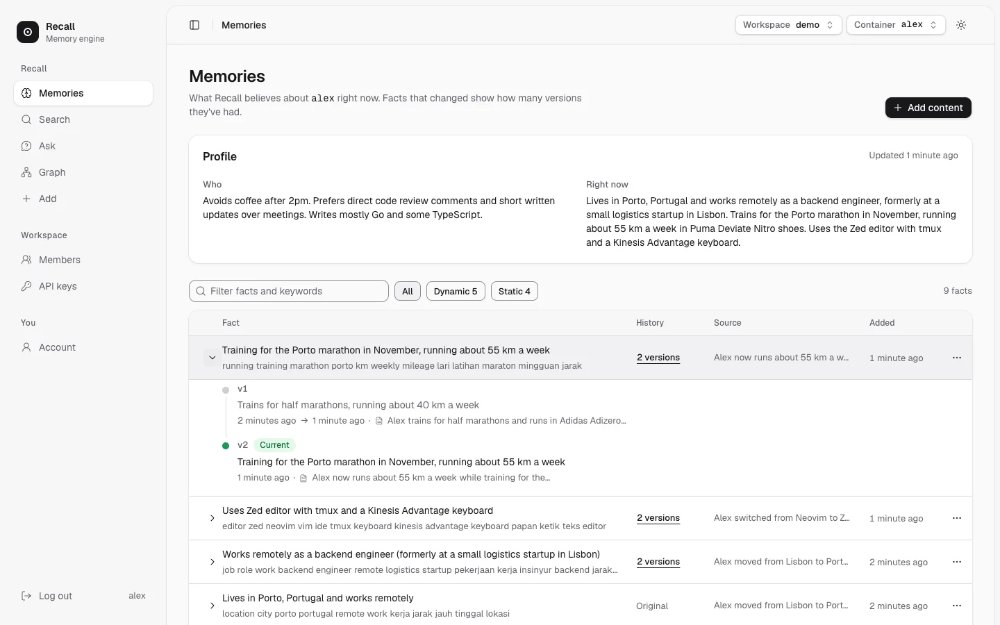

# Recall

A self-hosted memory engine for AI agents. You send it chats, notes, URLs or files. It pulls out short facts, keeps them current as things change, and gives them back to your agents through a REST API, an MCP server and a web dashboard.

I built it so Claude Code, claude.ai and my own apps share one memory about me and my projects, on hardware I control. It runs in production at https://recall.zakiego.com (sign-in is invite-only). Docs: https://recall.zakiego.com/docs.



## Features

- Facts that stay current. When new content contradicts an old fact, Recall writes a new version and closes the old one. History is kept. When it can't tell which one is right, it flags both for review.
- Fast local search. SQLite FTS5 and sqlite-vec, merged with reciprocal rank fusion. No LLM call on the search path, single-digit milliseconds once the embedding model is warm.
- Ask with citations. One LLM call over the top facts, answered only from them, with every claim linked to a fact.
- MCP server. Streamable HTTP at `/mcp` with an API key, or OAuth 2.1 (PKCE, dynamic client registration) so it works as a claude.ai custom connector.
- People. Extraction links facts to the people they mention and matches them by email, handle, name or alias. The dashboard can merge duplicates.
- Dates and reminders. Facts can carry an event or due date. An hourly job emails a daily digest of what's due.
- Connectors. Import Gmail messages, and pull changes from apps that expose a changes feed.
- Multi-user. Workspaces with owner, admin and member roles. Sign in with a password or a passkey. No public sign-up: accounts come from the admin CLI or an invite link.
- Claude Code hooks. Inject the profile at session start and send the session back at the end (`integrations/claude-code`).

## How it works

```
 agents, apps, dashboard
          │  REST /v1 · MCP /mcp · /app
          ▼
 ┌──────────────────────── one Go binary ────────────────────────┐
 │  HTTP API + MCP + auth/OAuth ──► SQLite (FTS5 + sqlite-vec)   │
 │            │                         ▲                         │
 │            ▼                         │                         │
 │  job loop: ingest → extract → profile ──► LLM gateway (HTTP)  │
 │            │                                                   │
 │            └──► embedder child process (ONNX Runtime, e5)      │
 └────────────────────────────────────────────────────────────────┘
```

1. `POST /v1/memories` stores the document and queues an ingest job. It returns 202 right away.
2. Ingest fetches or parses the content (readable HTML, PDF, text, chat), chunks it and embeds the chunks.
3. Extract sends the new content plus the 20 closest current facts to the LLM, which answers with facts to add, update or close.
4. A profile job rewrites the container's short summary.

Embeddings run on the box with `multilingual-e5-small` in a child process that exits when idle, so memory goes back to the OS between bursts. The LLM is reached through any OpenAI-compatible `/v1/chat/completions` endpoint.

## Stack

| Part | Tech |
|---|---|
| Server (`apps/server`) | Go, `net/http`, SQLite (`mattn/go-sqlite3` with FTS5, sqlite-vec), ONNX Runtime, hand-written SQL migrations |
| Dashboard (`apps/app`) | React, Vite, TanStack Router, Tailwind 4, embedded into the Go binary |
| Site and docs (`apps/site`) | Next.js static export with Fumadocs, on Cloudflare Pages |
| Edge (`apps/edge`) | Cloudflare Worker that splits traffic between the site and the app |
| Hooks (`integrations/claude-code`) | Node, no dependencies |
| Deploy | Distroless Docker image, Docker Compose |

## Quick start (Docker)

You need Docker and an OpenAI-compatible LLM endpoint for extraction.

```bash
git clone https://github.com/zakiego/recall.git && cd recall
cp env.example .env           # then set RECALL_URL, SESSION_SECRET, GATEWAY_URL, GATEWAY_KEY
docker compose up -d --build  # serves on 127.0.0.1:4800
docker compose exec app recall create-user me --workspace me --new-workspace   # prompts for a password
```

Open http://localhost:4800/app and sign in. Create an API key under Settings, API keys, then:

```bash
curl -X POST http://localhost:4800/v1/memories?wait=1 \
  -H "authorization: Bearer $KEY" -H 'content-type: application/json' \
  -d '{"container":"me","content":"I switched to Puma running shoes."}'

curl -X POST http://localhost:4800/v1/search \
  -H "authorization: Bearer $KEY" -H 'content-type: application/json' \
  -d '{"container":"me","q":"what shoes"}'
```

Connect Claude Code over MCP:

```bash
claude mcp add --transport http recall http://localhost:4800/mcp --header "Authorization: Bearer $KEY"
```

The port is published on loopback only. Put a reverse proxy or tunnel with TLS in front of it for anything beyond your own machine, and set `RECALL_URL` to that public origin.

## Configuration

All configuration is environment variables. `env.example` lists every one with a placeholder.

| Variable | Required | What it does |
|---|---|---|
| `RECALL_URL` | yes | Public origin (no `/app`). Used for cookies, passkeys, the trusted origin and invite links. Default `http://localhost:4800` |
| `SESSION_SECRET` | yes | 32+ random characters (`openssl rand -base64 48`). Signs OAuth hand-offs and encrypts OAuth client secrets. Without it, login is off |
| `GATEWAY_URL` | yes | OpenAI-compatible base URL serving streamed `/v1/chat/completions` |
| `GATEWAY_KEY` | yes | Bearer key for the gateway |
| `EXTRACT_MODEL` | no | Model for extraction, profiles and Ask. Default `claude-haiku-5-5` |
| `FALLBACK_MODEL` | no | Used when the gateway rejects `EXTRACT_MODEL`. Defaults to the same model |
| `ADMIN_PASSWORD_HASH` | no | Read only when there are no users: creates user `zaki` with this hash (`recall hash-password`) |
| `RECALL_DEFAULT_CONTAINER` | no | Container used when a request names none. Default `default` |
| `DATA_DIR` | no | Where `recall.db` and `models/` live. `/data` in the image |
| `PASSKEY_RP_ID` | no | Passkey relying party id. Defaults to the hostname of `RECALL_URL` |
| `RECALL_EMBED`, `RECALL_EMBED_IDLE_MS` | no | `child` (default) or `inline` embedder, and how long the child waits idle before exiting |
| `RECALL_JOBS` | no | `off` stops the job loop |
| `GOOGLE_CLIENT_ID`, `GOOGLE_CLIENT_SECRET`, `CONNECTOR_SECRET` | no | Gmail connector. Redirect URI `RECALL_URL/app/connectors/google/callback` |
| `RESEND_API_KEY`, `RECALL_EMAIL_FROM` | no | Reminder emails through Resend |

## API and MCP

Every `/v1` route takes `Authorization: Bearer rcl_...`. A key belongs to one workspace and only sees that workspace's data. The main routes:

| Route | What |
|---|---|
| `POST /v1/memories` | Add text, a chat, a URL or a file (up to 20 MB). `?wait=1` waits for the facts |
| `GET /v1/memories` | Current facts, `?history=1` for every version, `?review=1` for flagged ones |
| `PATCH`, `DELETE /v1/memories/:id` | Edit (writes a new version) or soft-delete a fact |
| `POST /v1/search` | Hybrid search over facts and document chunks |
| `POST /v1/ask` | A cited answer from the container's facts |
| `GET /v1/profile` | The container's summary and top facts |
| `GET /v1/people`, `GET /v1/upcoming` | People in the facts, and what's due soon |

MCP tools: `get_playbook`, `add_memory`, `search_memories`, `ask_memory`, `get_profile`, `list_memories`, `upcoming`, `list_people`, `get_person`, `list_documents`, `retry_document`. The full reference is in the [docs](https://recall.zakiego.com/docs) (source in `apps/site/content/docs`).

## Develop

The JS side is a pnpm workspace pinned to pnpm 10.17.0. Run it as `npx -y pnpm@10.17.0` (a newer global pnpm breaks this repo's `node_modules`). Every Go command takes `-tags sqlite_fts5`.

```bash
npx -y pnpm@10.17.0 install
apps/server/scripts/fetch-onnxruntime.sh                                            # ONNX Runtime, once per checkout
(cd apps/server && go run -tags sqlite_fts5 ./tools/fetch-model ../app/data/models)  # the e5 model (~120 MB), once
(cd apps/server && go build -tags sqlite_fts5 -o bin/recall ./cmd/recall)
(cd apps/server && DATA_DIR=../app/data bin/recall serve)   # API, MCP and jobs on :3000
(cd apps/app && npx vite dev)                               # dashboard at http://localhost:4800/app, API proxied to :3000
```

The server reads only its process environment, not an env file. Export your values first (`set -a; . ../app/.env; set +a`).

Tests:

```bash
(cd apps/server && go test -tags sqlite_fts5 ./...)       # needs the model and ONNX Runtime above
(cd apps/app && npx tsc --noEmit && npx vitest run)
node --test integrations/claude-code/test/*.test.mjs
```

`AGENTS.md` has the repo conventions (migrations, goldens, the RPC contract). `docs/GO-PORT.md` tells how the server was ported from TypeScript to Go with byte-for-byte golden tests. `docs/operations.md` covers deploys, backups and restores.

## License

[MIT](LICENSE)
